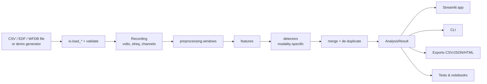

# ARCHITECTURE — ECG/EEG Signal Quality Checker

## 1. Tech stack (fixed; versions checked 2026-11-12)
| Layer | Choice | Purpose |
|---|---|---|
| Language | Python 3.12 (3.13 OK) | Everything |
| Numerics | NumPy ≥2.5, SciPy ≥1.18, pandas ≥3.1 | Arrays, filters, Welch spectrum, tables |
| EEG I/O | MNE-Python ≥1.13 | Read EDF/EDF+ |
| ECG I/O | WFDB ≥4.3 | Read PhysioNet WFDB records (Phase 2) |
| ECG helpers | NeuroKit2 ≥0.3 | R-peak detection (auxiliary) and simulated ECG |
| ML (Phase 4) | scikit-learn ≥1.9 | Isolation Forest |
| UI | Streamlit ≥1.67, Plotly ≥7.1 | Dashboard, interactive waveforms |
| Config | Python dataclasses (+ optional YAML via PyYAML) | Thresholds |
| Tests / CI | pytest, GitHub Actions | Automated tests |
| Hosting | Streamlit Community Cloud (free) | Public demo |

Not used: FastAPI, Docker, databases, cloud services. These are intentional choices (see `PRD.md` §7).

## 2. Folder layout
```text
ecg-eeg-quality-checker/
├── CLAUDE.md  PRD.md  ARCHITECTURE.md  DETECTORS.md  DESIGN.md  TASKS.md  DEPLOYMENT.md  START_HERE.md
├── README.md                     # public-facing (written in Phase 1, expanded later)
├── app.py                        # Streamlit entry point (UI only, no detection logic)
├── pyproject.toml                # package metadata + dependencies
├── requirements.txt              # for Streamlit Cloud: pinned deps + "-e ."
├── .streamlit/config.toml        # theme + maxUploadSize = 50
├── .github/workflows/tests.yml   # CI
├── src/signal_quality/
│   ├── __init__.py               # __version__
│   ├── models.py                 # dataclasses: Recording, Finding, AnalysisResult
│   ├── config.py                 # thresholds + defaults per modality
│   ├── io.py                     # load_csv, load_edf, (Phase 2: load_wfdb), validate
│   ├── preprocessing.py          # windowing, detrend, filters (copies, never in-place)
│   ├── features.py               # std, ptp, MAD, Welch PSD, band power, diffs
│   ├── detectors/
│   │   ├── __init__.py           # REGISTRY of detectors per modality
│   │   ├── flatline.py
│   │   ├── clipping.py
│   │   ├── powerline.py
│   │   ├── spikes.py
│   │   └── drift.py              # (Phase 2: noise.py, muscle.py, ocular.py, electrode_motion.py)
│   ├── merge.py                  # merge adjacent windows, de-duplicate overlapping findings
│   ├── analyze.py                # analyze_recording(): THE single engine entry point
│   ├── reporting.py              # to_dataframe, to_json, to_csv, (Phase 2: to_html)
│   ├── demo.py                   # simulated signals + artifact injection with labels
│   ├── plotting.py               # Plotly figure builders (used by app + notebooks)
│   └── cli.py                    # Phase 2
├── tests/
├── notebooks/                    # Phase 3
├── scripts/                      # Phase 3 evaluation scripts
├── data/README.md                # how to download datasets; data itself is git-ignored
├── reports/                      # evaluation outputs (Phase 3)
└── docs/DECISIONS.md             # log of minor decisions Claude Code made
```

## 3. Data models (`models.py`)
```python
@dataclass(frozen=True)
class Recording:
    signal_type: Literal["ECG", "EEG"]
    data: np.ndarray            # shape (n_channels, n_samples), VOLTS, read-only copy
    sfreq: float                # Hz, required, > 0
    channel_names: list[str]
    source: str                 # "simulated" | "upload:csv" | "upload:edf" | "physionet:<db>/<record>"
    data_kind: Literal["simulated", "real", "real_with_injected_artifacts"]
                                # always shown in the UI and exports; these three must never be confused
    is_simulated: bool          # == (data_kind == "simulated")
    meta: dict                  # non-identifying metadata only (duration, original units, file name)

@dataclass(frozen=True)
class Finding:
    signal_type: str
    channel: str
    start_s: float
    end_s: float
    category: str               # "flatline" | "clipping" | "powerline" | "spike" | "discontinuity" | "baseline_drift" | "large_transient" ...
    severity: Literal["low", "medium", "high"]
    certainty: Literal["definite", "likely", "uncertain"]
    rule: str                   # e.g. "std < 0.5 µV for ≥ 1.0 s"
    measurement: dict           # e.g. {"std_uV": 0.02, "threshold_uV": 0.5}
    explanation: str            # one plain-English sentence
    detector: str               # detector id + version, e.g. "flatline@1.0"

@dataclass
class AnalysisResult:
    recording_summary: dict     # signal type, sfreq, duration, channels, source, is_simulated
    findings: list[Finding]
    config: dict                # the exact thresholds used
    windows_analyzed: int
    windows_flagged: int
    skipped_checks: list[dict]  # e.g. {"check": "powerline_60Hz", "reason": "Nyquist 50 Hz < 66 Hz"}
    package_version: str
    created_at: str             # ISO timestamp
```

## 4. Data flow


`analyze_recording(recording, config=None, ml_model=None) -> AnalysisResult` is the only engine entry point.

## 5. Input validation (`io.py`)
Reject with a friendly `ValidationError` message when:
- the file type is unsupported, or the file is empty or zero-length
- the sampling rate is missing or not positive (CSV: the user must enter it; never guess)
- the unit is missing or unknown (accepted: `V`, `mV`, `uV`/`µV`; convert to volts)
- there are NaN/Inf values (Phase 1: reject and report count and location; Phase 2: option to mark as a "missing data" finding)
- channel names don't match the column count, or there are duplicate channel names
- the recording is shorter than 1 s (too short to analyze)
- the file is bigger than 50 MB

**CSV format:** one column per channel, header row = channel names. An optional first column named `time`/`time_s` is ignored for values but used to sanity-check `sfreq` (warn if inconsistent by more than 1%).
**EDF:** read with `mne.io.read_raw_edf(preload=True)`. MNE returns volts. Keep only EEG/ECG channel data plus names. **Drop all patient-identifying header fields.** Signal type is chosen by the user, with a suggestion: channel names containing "ECG"/"EKG" suggest ECG.

## 6. Windowing defaults (`config.py`)
| Modality | Window | Overlap | Why |
|---|---|---|---|
| EEG | 2.0 s | 50% | Long enough for a stable spectrum at 0.5 Hz resolution; short enough to localize artifacts |
| ECG | 4.0 s | 50% | Contains several heartbeats at normal rates |
If the recording is shorter than one window, analyze it as one window and add a note to `skipped_checks` for any check that needs a longer span.

## 7. Configuration
`config.py` defines `EEGConfig` and `ECGConfig` dataclasses. Every field has a unit in its name (e.g. `flat_std_uV`) and a rationale comment. `analyze_recording` accepts overrides. The exact config used is embedded in every `AnalysisResult` and export.

## 8. Performance and memory (free hosting ≈ 1 GB RAM)
- Process channel by channel; avoid copying full multi-channel arrays repeatedly.
- Plot downsampling: at most about 20,000 points per trace (min/max decimation), **display only**, never used for analysis.
- Cache demo generation and analysis in Streamlit (`st.cache_data`), keyed by inputs.
- Run analysis only when the Analyze button is pressed.

## 9. Security and privacy
- Uploaded files are processed in memory or a temp dir and never sent elsewhere.
- Uploaded content is never executed. Only established readers are used (pandas, MNE, WFDB).
- Exports contain no patient-identifying header fields.
