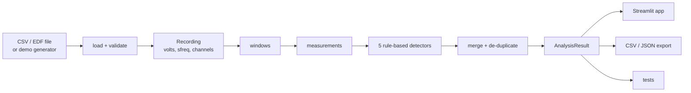

# ECG/EEG Signal Quality Checker

**Live demo:** _coming soon (link added after deployment)_

An explainable tool that finds **recording-quality problems (artifacts)** in ECG (heart) and EEG (brain) recordings. Every flag reports the channel, the time interval, a category, a severity, the exact rule and measurement that triggered it, and a one-sentence explanation.

> **Status: Phase 1 (demo), in progress.** Detection rules are implemented and tested on **simulated** signals only. **Not yet evaluated** on real recordings.

## What it detects (Phase 1)

| Problem | Typical cause | Rule (summary) |
|---|---|---|
| Flatline / dropout | Disconnected electrode, dead channel | σ and peak-to-peak below a tiny threshold for ≥ 1 s |
| Clipping / saturation | Amplifier hits its limit | Many samples sit at the channel's max/min in flat runs |
| Power-line interference | 50/60 Hz mains leaking in | Narrow spectral peak ≥ 10× its neighbours |
| Spikes / discontinuities | Electrode pops, cable motion, glitches | Jumps far steeper than the channel's normal variation (ECG uses a separate rule so heartbeats are not flagged) |
| Baseline drift / wander | Sweat, breathing, loose electrode | Large slow (< 0.3 Hz EEG / < 0.5 Hz ECG) movement |

The full rules, thresholds and rationale are in [DETECTORS.md](DETECTORS.md). Changes from that spec are logged in [docs/DECISIONS.md](docs/DECISIONS.md).

## Limitations (please read)
- It flags **recording problems**. It does **not** diagnose disease or detect arrhythmias or seizures.
- It does **not** decide whether a signal is real or AI-generated.
- Thresholds are reasonable starting points, **not clinically validated** values. Unusual but genuine physiology can be flagged, and the wording reflects that ("possible", "likely").
- Certainty labels (`definite` / `likely` / `uncertain`) are **rule-based labels, not probabilities**.
- The demo signals are **simulated**, and "detects every injected artifact in the demo" says nothing about accuracy on real recordings. Real-data evaluation (PhysioNet) is planned for Phase 3: **not yet evaluated**.
- "No findings" does not prove a recording is clean; only the five checks above are run.

## Install and run (Mac)
```bash
cd ~/Projects/ecg-eeg-quality-checker
python3.12 -m venv .venv            # Python 3.12 or 3.13
source .venv/bin/activate
pip install -r requirements.txt
streamlit run app.py                # opens the dashboard in your browser
pytest -q                           # runs the automated tests
```

In the app: pick a demo signal → **Analyze** → turn on **Show injected-artifact ground truth** to compare injected vs detected. You can also upload your own **CSV** (you must enter the sampling rate and unit) or **EDF/EDF+** file (up to 50 MB).

**CSV format:** one column per channel with a header row of channel names. An optional first column `time` / `time_s` is used only to sanity-check the sampling rate.

### Use it from Python
```python
from signal_quality.io import load_csv
from signal_quality.analyze import analyze_recording
from signal_quality.reporting import to_dataframe

rec = load_csv("my_ecg.csv", sfreq=360, unit="mV", signal_type="ECG")
result = analyze_recording(rec)            # the single analysis engine
print(to_dataframe(result))
```

## How it works

- Signals are stored in **volts** and shown in **µV (EEG)** or **mV (ECG)**. The original signal is never modified.
- `signal_quality.analyze.analyze_recording()` is the **only** analysis entry point. The app and the tests call it, and no detection logic is copied anywhere else.
- Every threshold lives in `src/signal_quality/config.py` with its unit and a rationale, and can be overridden. The exact settings used are embedded in every export.
- Exports never include patient-identifying EDF header fields.

## Project layout
```text
app.py                      Streamlit dashboard (UI only)
src/signal_quality/         the Python package (models, config, io, detectors, merge, analyze, reporting, demo, plotting)
tests/                      pytest tests (fixtures generated in code)
docs/DECISIONS.md           log of build decisions
data/README.md              datasets for later phases (no data committed)
```

## Roadmap
- **Phase 2:** WFDB loading, more detectors (noisy channel, muscle/high-frequency noise, electrode motion, ocular, missing data), physiological plausibility hints (always `uncertain`), HTML report, command-line tool.
- **Phase 3:** reproducible evaluation on PhysioNet data with controlled injected artifacts; notebooks; methodology.
- **Phase 4:** optional Isolation Forest anomaly score (uncalibrated), compared honestly with the rules.
- **Phase 5:** polish, final README with real results.

## Citations
- Makowski D. et al. (2021). *NeuroKit2: A Python toolbox for neurophysiological signal processing.* Behavior Research Methods 53, 1689–1696. https://doi.org/10.3758/s13428-020-01516-y
- Gramfort A. et al. (2013). *MEG and EEG data analysis with MNE-Python.* Frontiers in Neuroscience 7:267. https://doi.org/10.3389/fnins.2013.00267
- Xie C. et al. *WFDB Software Package for Python.* PhysioNet. https://doi.org/10.13026/9njx-6322
- Goldberger A. et al. (2000). *PhysioBank, PhysioToolkit, and PhysioNet.* Circulation 101(23):e215–e220. https://doi.org/10.1161/01.CIR.101.23.e215

## Author
Joseph Bui · Applied Mathematics & Statistics, Johns Hopkins University · project ongoing since July 2026 (rebuilt from scratch in November 2026).
